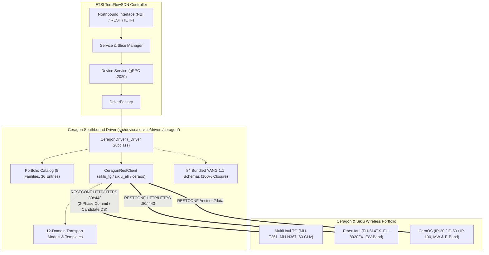

# ETSI TeraFlowSDN Controller

The [ETSI Software Development Group TeraFlowSDN (SDG TFS)](https://tfs.etsi.org/) is developing an open source cloud native SDN controller enabling smart connectivity services for future networks beyond 5G.

The project originated from "[Teraflow H2020 project](https://teraflow-h2020.eu/) - Secured autonomic traffic management for a Tera of SDN Flows", a project funded by the European Union’s Horizon 2020 Research and Innovation programme that finished on 30th June 2023.

---

## Ceragon Wireless Radio Transport Driver (Southbound Interface)

This repository includes the native **Ceragon Wireless Radio Transport Driver** (`src/device/service/drivers/ceragon/`), providing ETSI TeraFlowSDN with Southbound Interface (SBI) control and bidirectional telemetry streaming across the entire Ceragon Networks & Siklu-by-Ceragon wireless transport portfolio (**5 product families, 31 explicit hardware models + 5 family fallbacks, 12 control domains, and 84 YANG 1.1 schemas with 100% dependency closure**).

### Key Capabilities

- **Full 5-Family Portfolio Catalog (`portfolio.py`)**: Resolves 31 explicit hardware models (`IP-20C`, `IP-20C-HP`, `IP-20S`, `IP-20E`, `IP-20V`, `IP-20N`, `IP-20A`, `IP-20A-LH`, `IP-20G`, `IP-20GX`, `IP-50C`, `IP-50CX`, `IP-50E`, `IP-50EX`, `IP-50EXA`, `IP-50FX`, `IP-100E`, `EH-614TX`, `EH-710TX`, `EH-1200TX`, `EH-1200FX`, `EH-2500FX`, `EH-8010FX`, `EH-8020FX`, `MH-T261`, `MH-T260`, `MH-T265`, `MH-T280`, `MH-N265`, `MH-N366`, `MH-N367`) and 5 family fallbacks (`IP-20`, `IP-50`, `IP-100`, `EtherHaul`, `MultiHaul TG`) to their exact API flavor (`siklu_tg`, `siklu_eh`, `ceraos`), RF bands, and hardware capability bitmask.
- **RFC 8040 RESTCONF Candidate Datastore & CeraOS Running DS Architecture**: Full transaction management utilizing the 2-Phase Commit pattern (`PATCH /restconf/ds/ietf-datastores:candidate` followed by atomic `ietf-netconf:commit`, with automated rollback via `discard-changes` on validation failure) for Siklu/Terragraph devices and direct RFC 8040 `/restconf/data` editing for CeraOS (`IP-20` / `IP-50` / `IP-100`).
- **12 Bidirectional Control Domains**: Southbound `SetConfig` and `DeleteConfig` across `radio_tuning`, `acm`/`modulation`, `qos` (8-CoS SP+DRR & IEEE 802.1Qbv GCL), `slice` (VLAN & PIR shapers), `protection` (1+1 HSB, Space Diversity, Terragraph `active-backup`), `beamforming` (60 GHz beam index & `start-topo-scan` RPC), `multiband` (E-band + MW L1 bonding), `sync` (ITU-T G.8275.1 PTP + SyncE), `security` (IEEE 802.1AE MACsec AES-128/256-GCM), `energy` (Green-ATPC & carrier sleep), `oran_xhaul` (Split 7.2x eCPRI BFP9), and `interference` (XPIC + ATPC boost).
- **84 Bundled YANG 1.1 Data Models (100% Dependency Closure)**: Complete RFC-compliant schema library (`schemas/yang/`) covering 62 Siklu/Terragraph modules (`radio-bridge-tg-*`, `ietf-snmp-*` submodules, NMDA/RESTCONF), `radio-bridge-eh-radio.yang` for EtherHaul, 10 CeraOS modules (`ceragon-*.yang`), and IETF/IEEE standard modules (`ietf-microwave-radio-link` RFC 8561, `ieee802-dot1q-sched` 802.1Qbv, `ieee802-dot1ae-macsec`, `ietf-ptp`, `ietf-interfaces`, `ietf-hardware`, `ietf-system`) with **0 missing imports or includes, 58 RPCs, and 5 notifications**.
- **Bidirectional Telemetry & Event Streaming (`Subscribe` / `Unsubscribe`)**: Northbound background polling and event/alarm detection streaming RSL, SNR, SINR, modulation, throughput, BER/ES/SES, temperature, power, PTP time error, and protection state into the TFS Monitoring Service.

### Supported Hardware Families

| Hardware Family | Model Series | Frequency Band | Max Throughput | API Flavor | Bundled YANG Schemas |
| :--- | :--- | :--- | :--- | :--- | :--- |
| **MultiHaul TG** | `MH-T261` *(lab-verified)*, `MH-T260`, `MH-T265`, `MH-T280`, `MH-N265`, `MH-N366`, `MH-N367` | 57–71 GHz (V-Band Terragraph) | Up to 16 Gbps | `siklu_tg` (RFC 8040 Candidate DS) | 62 modules (`radio-bridge-tg-*`, `ietf-snmp-*`, NMDA) |
| **EtherHaul** | `EH-614TX`, `EH-710TX`, `EH-1200TX`, `EH-1200FX`, `EH-2500FX`, `EH-8010FX`, `EH-8020FX` | 57–66 GHz & 71–86 GHz (E-Band) | Up to 20 Gbps | `siklu_eh` (RESTCONF Candidate DS) | `radio-bridge-eh-radio.yang` + shared Siklu & IETF models |
| **FibeAir IP-20** | `IP-20C`, `IP-20C-HP`, `IP-20S`, `IP-20E`, `IP-20V`, `IP-20N`, `IP-20A`, `IP-20A-LH`, `IP-20G`, `IP-20GX` | 4–42 GHz MW, 60 GHz, 71–86 GHz | Up to 10 Gbps | `ceraos` (RESTCONF `/restconf/data`) | 10 `ceragon-*.yang` + `ietf-microwave-radio-link` (RFC 8561) |
| **FibeAir IP-50** | `IP-50C`, `IP-50CX`, `IP-50E`, `IP-50EX`, `IP-50EXA`, `IP-50FX` | 6–42 GHz MW & 71–86 GHz Multi-Band | Up to 25 Gbps | `ceraos` (RESTCONF `/restconf/data`) | 10 `ceragon-*.yang` + `ieee802-dot1q-sched` + `ieee802-dot1ae-macsec` + `ietf-ptp` |
| **IP-100** | `IP-100E` | 71–86 GHz Dual-Carrier E-Band | Up to 25 Gbps | `ceraos` (RESTCONF `/restconf/data`) | 10 `ceragon-*.yang` + RFC 8561 + IEEE 802.1Qbv / 802.1AE |

---

### Architecture Overview



---

### Quick Start: Onboarding a Ceragon Device in TFS

Onboard a Ceragon device by uploading a standard TFS descriptor via the WebUI or the NBI REST API:

```bash
curl -X POST http://<tfs-ip>:8088/api/v1/devices \
  -H "Content-Type: application/json" \
  -d @manifests/ceragon_mh_t261_descriptor.json
```

**Descriptor Example (`manifests/ceragon_mh_t261_descriptor.json`)**:

```json
{
  "devices": [
    {
      "device_id": {
        "device_uuid": {
          "uuid": "ceragon-mh-t261-ctu-96"
        }
      },
      "device_type": "microwave-radio-system",
      "device_config": {
        "config_rules": [
          {
            "action": 1,
            "custom": {
              "resource_key": "_connect/address",
              "resource_value": "192.168.1.225"
            }
          },
          {
            "action": 1,
            "custom": {
              "resource_key": "_connect/port",
              "resource_value": "80"
            }
          },
          {
            "action": 1,
            "custom": {
              "resource_key": "_connect/settings",
              "resource_value": {
                "username": "admin",
                "password": "admin",
                "scheme": "http",
                "timeout": 15
              }
            }
          }
        ]
      },
      "device_operational_status": 1,
      "device_drivers": [22],
      "device_endpoints": []
    }
  ]
}
```

---

### Running the Ceragon Driver Unit Tests

Run the full pytest suite from the repository root:

```bash
PYTHONPATH=src python -m pytest -v src/device/tests/test_driver_ceragon.py
```

### Detailed Documentation & Specifications

- **Driver Reference & Usage**: [`src/device/service/drivers/ceragon/README.md`](src/device/service/drivers/ceragon/README.md)
- **Technical Driver Specification**: [`docs/CERAGON_DRIVER_SPECIFICATION.md`](docs/CERAGON_DRIVER_SPECIFICATION.md)
- **Master Specification**: [`docs/CERAGON_TERAFLOWSDN_MASTER_SPECIFICATION.md`](docs/CERAGON_TERAFLOWSDN_MASTER_SPECIFICATION.md)
- **Contribution Guide**: [`docs/ETSI_TFS_CONTRIBUTION_GUIDE.md`](docs/ETSI_TFS_CONTRIBUTION_GUIDE.md)

---

## Available branches and releases

[](https://labs.etsi.org/rep/tfs/controller/-/releases)

- The branch `main` points to the primary branch of this fork, containing the official ETSI TeraFlowSDN 7.0 release integrated with the Ceragon Southbound REST adapter.
- The branch `feat/ceragon-transport-driver` tracks dedicated feature development for the Ceragon driver.

## Documentation
The [TeraFlowSDN Wiki](https://labs.etsi.org/rep/tfs/controller/-/wikis/home) pages include the upstream documentation for the ETSI TeraFlowSDN Controller.
